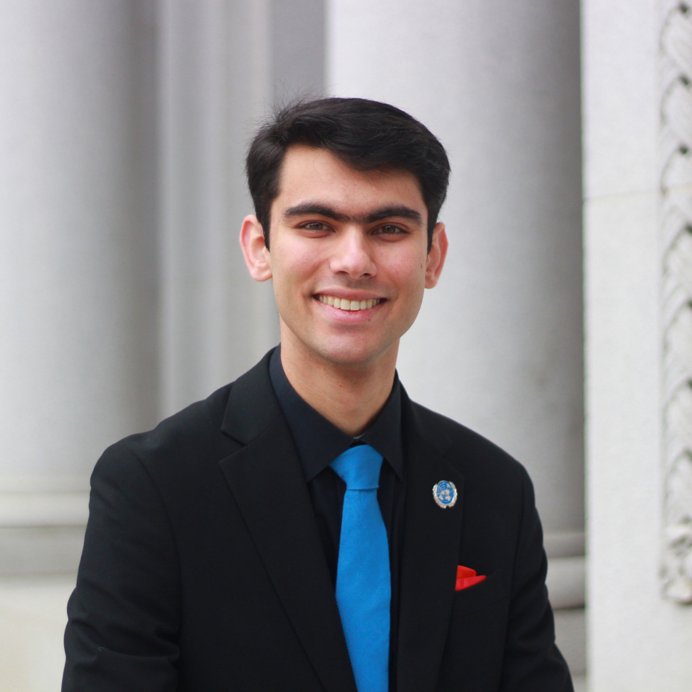

---
    title: Parth Nobel
...

{ width=50%}

Co-Founder and CTO, [Optimal Intellect](https://optimalintellect.com)  
Maintainer, CVXPY  
<parthnobel@berkeley.edu>

# Bio

I am a maintainer and Technical Steering Council member for [CVXPY](https://www.cvxpy.org) and [CVXPYlayers](https://github.com/cvxgrp/cvxpylayers).

I did my PhD at Stanford University with Professors [Stephen Boyd](https://web.stanford.edu/~boyd/) and [Emmanuel Candès](https://statweb.stanford.edu/~candes/).
I was supported by the National Science Foundation Graduate Research Fellowship Program (NSF GRFP).

During my PhD, I interned at Amazon Supply Chain Optimization Technologies (SCOT) and [Gridmatic](https://www.gridmatic.com/).
In undergrad, I interned at Apple working on embedded systems and scientific computing and at HP working on data infrastructure.

While at Stanford, I was the instructor for the summer offering of [EE364a/CME364a](https://web.stanford.edu/class/ee364a/), Stanford's optimization course;
as the instructor I revised the class content and lecture slides for the first time in over two decades.
[The new slides are available here](https://web.stanford.edu/class/ee364a/lectures.html).
I also co-developed and taught a shorter version of the course as a professional development course at NASA; [those course materials are available here](https://cvxgrp.org/nasa/).
In other quarters, I was Head TA for [EE364a/CME364a](https://web.stanford.edu/class/ee364a/) and [Engr108](https://web.stanford.edu/class/engr108/), an introductory linear algebra course.
As an undergrad, I was the sole TA for [EECS219A](https://aam.roychowdhury.net/classWiki/tiki-index.php?page=EECS219A-Spring-2021), Berkeley's graduate numerical simulation and modeling class.

For part of my PhD, I was a Visiting Scholar at UC Berkeley working with [Riley Murray](https://rileyjmurray.wordpress.com/), Professor [Michael Mahoney](https://www.stat.berkeley.edu/~mmahoney/), and Professor Jim Demmel on randomized numerical linear algebra as part of the [BALLISTIC Project](https://www.netlib.org/lapack/lawnspdf/lawn297.pdf).

Prior to attending Stanford, I was a Regents' and Chancellor's Scholar at UC Berkeley where I earned a Bachelors of Science in Electrical Engineering and Computer Science (EECS). I worked with Professor [Jaijeet Roychowdhury](https://jaijeet.github.io/jrpages/index.html) on system theory and numerical methods.

# Publications

* **P. Nobel**. John Williams wrote a fanfare for Mike Dukakis. I had to hear it. *The Boston Globe*. October 16, 2026. <https://www.bostonglobe.com/2026/10/16/opinion/john-williams-mike-dukakis-theme-song/>
* P. Rathore, Z. Frangella, **P. Nobel**, X. Hu, M. Udell. GPU-Enabled Large-Scale Optimization Using Randomized Linear Algebra. [arXiv:2609.08136 [cs.LG]](https://arxiv.org/abs/2609.08136)
* W. Zhang, **P. Nobel**, A. Jeendgar, R. Murray, P. Schiele, S. Diamond. CVXPY 1.9: Recent Advances in Optimization Modeling Software. [arXiv:2606.14891 [math.OC]](https://arxiv.org/abs/2606.14891)
* Q. Healey, **P. Nobel**, S. Boyd. Differentiating Through a Quadratic Cone Program. *Optimization Letters*. 2026. <https://doi.org/10.1007/s11590-026-02315-8>
* D. Cederberg, W. Zhang, **P. Nobel**, S. Boyd. Disciplined Nonlinear Programming. [arXiv:2606.02896 [math.OC]](https://arxiv.org/abs/2606.02896)
* **P. Nobel**, A. Rozenshtein, C. Sharma. Untangling AI Openness. *Wisconsin Law Review*. 2026. <https://wlr.law.wisc.edu/wp-content/uploads/sites/1263/2026/03/4-Nobel-Rozenshtein-Sharma-%E2%80%93-Camera-ready.pdf>
* Y. Chen, D. Tse, **P. Nobel**, P. Goulart, S. Boyd. CuClarabel: GPU Acceleration for a Conic Optimization Solver. *ACM Transactions on Mathematical Software*. 2026. <https://dl.acm.org/doi/10.1145/3815420>
* **P. Nobel**, A. Rozenshtein, C. Sharma.  Open-Access AI: Lessons From Open-Source Software. The Lawfare Institute. <https://www.lawfaremedia.org/article/open-access-ai--lessons-from-open-source-software>
* **P. Nobel**, D. LeJeune, E. Candès. RandALO: Out-of-sample Risk Estimation in No Time Flat. [arXiv:2409.09781 [math.ST]](https://arxiv.org/abs/2409.09781)
* T. Marcucci, **P. Nobel**, R. Tedrake, S. Boyd. Fast Path Planning Through Large Collections of Safe Boxes.
*IEEE Transactions on Robotics*. 2024. <https://ieeexplore.ieee.org/document/10612232>
* J. Sun, Y. Jiang, J. Qiu, **P. Nobel**, M. Kochenderfer, M. Schwager. Conformal Prediction for Uncertainty-Aware Planning with Diffusion Dynamics Model. *NeurIPS 2023*. <https://neurips.cc/virtual/2023/poster/71449>
* **P. Nobel**, E. Candès, S. Boyd. Tractable Evaluation of Stein's Unbiased Risk Estimate for Convex Regularizers. *IEEE Transactions on Signal Processing*. 2023. <https://doi.org/10.1109/TSP.2023.3323046>
* **P. Nobel**, A. Agrawal, S. Boyd. Computing Tighter Bounds on the $n$-Queens Constant via Newton's Method. *Optimization Letters* **17**, 1229–1240 (2023). <https://doi.org/10.1007/s11590-022-01933-2>
* T. Wang, L. Wu, **P. Nobel**, and J. Roychowdhury. Solving Combinatorial Optimisation Problems Using Oscillator Based Ising Machines. *Natural Computing* **20**, 287–306 (2021). <https://doi.org/10.1007/s11047-021-09845-3>
* **[Invited Paper]** T. Wang, L. Wu, **P. Nobel**, and J. Roychowdhury. Solving Combinatorial Optimisation Problems Using Oscillator Based Ising Machines. Unconventional Computation and Natural Computation (UCNC), August 2020.
* **P. Nobel**. `auto_diff`: An Automatic Differentiation Package for Python, SpringSim'20, May 2020. <https://dl.acm.org/doi/10.5555/3408207.3408219>

# Miscellaneous Other Writings

I occasionally did significant writing for the UC Berkeley Model UN. That work is provided below:

* [Conference on the Laws of War for the Cyber Era Background Guide](/pdfs/war.pdf) 
* [Excerpts addressing power grid infrastructure from Group of Latin American and Caribbean Countries: 2020 Background Guide](/pdfs/grulac.pdf)
* [US Senate: Data Privacy Background Guide](/pdfs/data-privacy.pdf)

I also have written quick-reference theorem lists for a couple classes at Berkeley. Other people have told me they're useful. I make no guarantees about the absence or presence of typos. 

* [EE 120: Signals and Systems, Spring 2020 w/ Babak Ayazifar](/pdfs/EE120_Notes.pdf)
* [Math 123: Ordinary Differential Equations, Fall 2020 w/ Di Fang](/pdfs/math123-final-thm-list.pdf)
* [Math 185: Complex Analysis, Spring 2021 w/ Di Fang](/pdfs/math185-thm-list.pdf)
